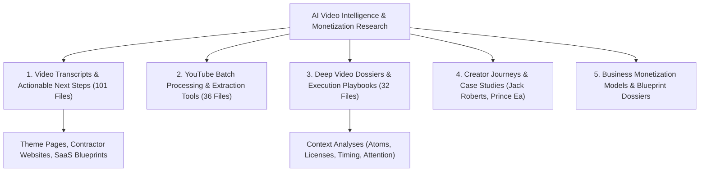

# 🎬 AI Video Intelligence, Transcripts & Market Monetization Research

A master research compendium containing **231+ video intelligence dossiers**, automated transcript extractions, creator journey breakdowns, and market monetization execution playbooks developed by **Sanjeev Kumar ([@Nova-Jaat](https://github.com/Nova-Jaat))**.

---

## 🗂️ Repository Architecture

---

## 📂 Section Directory

| Section | Focus Domain | Files | Description |
|:---|:---|:---:|:---|
| **[video-transcripts-and-analyses/](video-transcripts-and-analyses/)** | Video Intelligence & Next Steps | 101 | Raw transcripts, structured summaries, and immediate execution steps for AI theme pages, contractor lead generation, and digital agency services. |
| **[youtube-tab-batch-processors/](youtube-tab-batch-processors/)** | Automation & Batch Scripts | 36 | Python generators (`generate_batch1.py`), test suites, and batch transcript processing tools. |
| **[video-dossiers-and-playbooks/](video-dossiers-and-playbooks/)** | Deep Dossiers & Playbooks | 32 | Deep context analyses covering physical businesses, media engines, niche marketplaces, proprietary databases, and AI agencies. |
| **[creator-journeys-and-case-studies/](creator-journeys-and-case-studies/)** | Creator Case Studies | 3 | In-depth creator breakdowns (Jack Roberts AI automations, Prince Ea creator journey, Roland Wolf 1k paydays). |
| **[business-monetization-models/](business-monetization-models/)** | Business Blueprints | 3 | Solo AI Business Blueprint, Digital Product Next Move roadmap, and playlist analysis. |

---

## 🔗 Related Repositories in this Portfolio

* 🛠️ **[ChatGPT----CloudOPS-Related](https://github.com/Nova-Jaat/ChatGPT----CloudOPS-Related)**: 44 TechOps production guides, modern AI infra stack, and master roadmaps.
* 💼 **[JD-Analyzation----Remote-JOB-Related-Data-Analyzation](https://github.com/Nova-Jaat/JD-Analyzation----Remote-JOB-Related-Data-Analyzation)**: 11 Batches analyzing 50+ remote Cloud & DevOps jobs.
* 💻 **[Web-Monetization-Apps](https://github.com/Nova-Jaat/Web-Monetization-Apps)**: Frontend dashboards and interactive ATS search launcher.
* 🛡️ **[Mindmap-shiv](https://github.com/Nova-Jaat/Mindmap-shiv)**: Cybersecurity & DevSecOps visual mindmaps.

---

### 👨‍💻 Maintained By
**Sanjeev Kumar ([@Nova-Jaat](https://github.com/Nova-Jaat))**  
*Cloud, DevOps & DevSecOps Platform Engineer*
