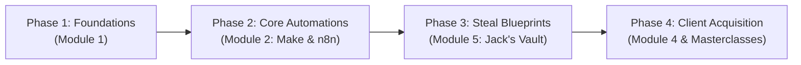

# Jack Roberts - AI Automations by Jack: Comprehensive Archive Analysis & Breakdown

## 1. Resource Metadata

| Property | Details |
| :--- | :--- |
| **Source URL** | `https://mega.nz/folder/NBVjhQQY#HZt-I60VW-TaF2KQU1D-6Q` |
| **Folder Name** | `Jack Roberts - AI Automations by Jack` |
| **Total Archive Size** | **76.36 GB** (81,988,880,988 bytes) |
| **Total Items** | **994 items** (959 files across 35 directories) |
| **Instructor / Author** | **Jack Roberts** (AI Automation Creator, Agency Founder & Skool Host) |
| **Community / Platform** | **Skool Community Archive** ("AI Automations by Jack" Classroom) |
| **Primary Media Formats** | **262 Video Lessons** (`.mp4`), **275 HTML Lesson Walkthroughs** (`.html`), **191 Importable Blueprints** (`.json`), **90 Guides/Prompts** (`.docx`), **89 System Scripts** (`.txt`), **25 Reference Guides** (`.pdf`), **9 Compressed Packages** (`.zip`), **6 Images** (`.png`), **4 Spreadsheets** (`.xlsx`), **1 Dataset** (`.csv`) |

---

## 2. Directory Hierarchy & Archive Inventory

```text
📁 Jack Roberts - AI Automations by Jack/ ................................. [76.36 GB | 959 files]
│
├── 📄 Classroom - AI Automations by Jack.png (1.71 MB)
├── 📄 Note.txt (Instructions: Download .html files and open in web browser)
│
├── 📁 1 AI Foundations .................................................. [3.11 GB | 52 files]
│   ├── 📁 1 Start here (Welcome, Roadmap, Tools, Support, Level Nav) ..... [398.1 MB | 20 files]
│   └── 📁 2 Al Foundations (Prompting, RAG, Memory, Selling AI OS) ....... [2.72 GB | 32 files]
│
├── 📁 2 AI Automations .................................................. [7.88 GB | 93 files]
│   ├── 📁 1 Start here (Pathways & Learning Goals) ....................... [60.4 MB | 4 files]
│   ├── 📁 2 Make (Intro, Router logic, Demoing, Webhooks, AI Integrations) [3.63 GB | 23 files]
│   ├── 📁 3 n8n (First Agents, Architecture, 30 Hidden Features) ......... [2.96 GB | 15 files]
│   ├── 📁 4 n8n Advanced (Custom Data Nodes, Triggers, Workbooks, JSON) .. [1.18 GB | 47 files]
│   └── 📁 5 Certification (Foundations & Bonus Ecosystem Tools) .......... [50.7 MB | 4 files]
│
├── 📁 3 Advanced Technology ............................................. [5.91 GB | 111 files]
│   ├── 📁 1 Start here (Overview of Advanced Tech) ....................... [40.0 MB | 2 files]
│   ├── 📁 2 Advanced Technologies (Custom GPTs, Chrome Ext, Dashboards) .. [1.99 GB | 17 files]
│   └── 📁 3 Advanced n8n Weaponry (Multi-Agent, Vapi, WhatsApp, GHL) ..... [3.88 GB | 92 files]
│
├── 📁 4 Make Money ...................................................... [12.01 GB | 51 files]
│   ├── 📁 1 Level 1 - Personal Life (Finances, Mindset, Systems) ........ [1.77 GB | 14 files]
│   ├── 📁 2 Level 2 - Foundations (Core Value, Rory Sutherland Principles) [0.98 GB | 8 files]
│   ├── 📁 3 Level 3 - Pathway (Niche Selection, Preventing Shiny Object) . [0.84 GB | 6 files]
│   ├── 📁 4 Your First Al Dollar (Avatar, Winning Offer, 1st Customer) ... [6.29 GB | 16 files]
│   └── 📁 5 Bonus (Lessons from Alex Hormozi) ............................ [1.19 GB | 4 files]
│
├── 📁 5 Jacks Al Automations (Plug-and-Play Workflow Vault) ............. [28.01 GB | 566 files]
│   ├── 📁 01 Social Media (Viral IG Reels, YouTube Scrapers, Metricool) .. [7.67 GB | 156 files]
│   ├── 📁 02 Voice (Vapi AI Appointment Setter, Approval Systems) ........ [0.87 GB | 27 files]
│   ├── 📁 03 Special or General Als (DeepSeek, Claude, Lovable, Bolt.new) . [9.11 GB | 165 files]
│   ├── 📁 04 Lead Generation (1,000s Scraped Leads, Video Outreach) ...... [1.78 GB | 33 files]
│   ├── 📁 05 Image & Video (Midjourney, Flux, Google Veo 3, Video Clones) . [1.68 GB | 27 files]
│   ├── 📁 06 Newsletter (Automate 95% of Newsletters, Lead Magnets) ...... [0.54 GB | 14 files]
│   ├── 📁 07 Al Agents (Autonomous RAG, Make AI Agents, DeepSeek R1) ..... [0.57 GB | 16 files]
│   ├── 📁 08 Make Money ($997/mo WhatsApp Bot, Micro SaaS, Client Portals) [3.47 GB | 80 files]
│   ├── 📁 09 Resources (Prompt Swipe Files & Helper Code) ................. [0.12 GB | 8 files]
│   ├── 📁 10 Assets (Branding Graphics, UI Kits & Components) ............. [0.01 GB | 18 files]
│   ├── 📁 11 Bonus (Premier Pro 6-hr Course, OBS & SEO Masterclass) ...... [2.09 GB | 17 files]
│   └── 📁 12 Business Systems (Complete Client AI Booking OS) ............. [0.11 GB | 5 files]
│
└── 📁 6 Masterclasses (40 Deep-Dive Expert Sessions) .................... [19.43 GB | 84 files]
    └── 40 full-length video masterclasses covering high-ticket sales, client acquisition,
        neuro-marketing, cold outreach, personal branding, and AI tool creation.
```

---

## 3. Module Breakdown (In Simple Terms)

### 📌 Module 1: AI Foundations (`3.11 GB`)
* **Purpose:** Demystifying AI technology and establishing proper mental models before opening any software.
* **Key Lessons:**
  * **Core Philosophy:** Moving away from selling simple "toys" or isolated GPT wrappers. Instead, positioning yourself as an **AI Operating Systems (AIOS)** architect for real businesses.
  * **Context Engineering & Memory:** How token limits work, how to craft system prompts that do not drift, and how vector databases retrieve proprietary data (**RAG - Retrieval Augmented Generation**).
  * **Tool Stack Setup:** Setting up OpenAI, Anthropic Claude, Perplexity, and workspace infrastructure without overspending.

### ⚙️ Module 2: AI Automations - Make.com & n8n (`7.88 GB`)
* **Purpose:** The core technical training on the two dominant visual orchestration platforms.
* **Make.com Mastery:**
  * Setting up routers, conditional filters, error handling, and webhooks.
  * How to build and **live-demo** an automation to prospective clients to guarantee buy-in.
* **n8n Deep Dive:**
  * Why open-source/self-hosted n8n is superior to Make for enterprise workflows and privacy.
  * Node-by-node logic, triggers, JSON manipulation, and data transformation.
  * 30 hidden n8n features and how to avoid execution bottlenecks.
* **Certification & Projects:** Includes follow-along exercises connecting Carrd, Typeform, Airtable, and Gmail into functional pipelines.

### 🚀 Module 3: Advanced Technology & n8n Weaponry (`5.91 GB`)
* **Purpose:** Moving beyond linear "if this, then that" workflows into autonomous multi-step systems.
* **Key Lessons:**
  * **Linear Chains vs. Autonomous Agents:** Knowing when to use strict deterministic workflows versus autonomous reasoning loops.
  * **Human-in-the-Loop:** Designing approval mechanisms where AI drafts actions (emails, proposals, social posts) and requests human sign-off via Slack, Telegram, or WhatsApp before sending.
  * **Telephony & Real-time Integrations:** Connecting **Vapi** voice agents, **Twilio**, **WhatsApp Business API**, and **GoHighLevel (GHL)** CRM.
  * **AI Web Apps:** Rapidly prototyping customer-facing dashboards using modern vibe-coding platforms like **Lovable.dev** and **Bolt.new**.

### 💼 Module 4: Make Money — Agency & Business Playbook (`12.01 GB`)
* **Purpose:** Transforming automation skills into high-margin recurring income.
* **Key Lessons:**
  * **Niche Selection & Avatar Clarity:** The *"One Channel, One Avatar, One Offer"* framework.
  * **Value Creation:** Rory Sutherland’s behavioral economics applied to selling B2B automation.
  * **High-Ticket Offer Packaging:** Transitioning from low-priced gig work ($50-$200) to retained client systems ($997/month recurring + $3,000+ upfront setup).
  * **Outreach Mechanics:** Step-by-step cold outreach, booking qualified discovery calls, and objection handling.
  * **Bonus:** Alex Hormozi frameworks applied to lead magnets and client retention.

---

## 4. The Automation Blueprint Vault: `5 Jacks Al Automations` (`28.01 GB`)

This is the crown jewel of the archive. It contains **191 plug-and-play `.json` workflow files**, prompt documents, and companion videos organized into 12 sub-categories:

### 1. 📱 Social Media Engines (`7.67 GB` · 156 items)
* **Unlimited Viral Instagram Posts:** Ingests high-performing competitors, extracts hooks, generates original carousels, and sends designs directly to Canva.
* **Blog-to-50-Posts Engine:** Converts a single article or video transcript into 50 platform-optimized snippets (LinkedIn, Twitter/X, Threads).
* **Automated Video Repurposing:** Scrapes YouTube/TikTok videos, generates auto-transcriptions, extracts virality timestamps, and schedules clips via Metricool.

### 2. 📞 Voice Agents (`0.87 GB` · 27 items)
* **Vapi AI Inbound/Outbound Setter:** Complete n8n webhook pipelines connected to Vapi.ai and ElevenLabs for natural conversational voice calls that check calendar availability and book appointments.
* **Voice-Activated Approval Systems:** Send a voice note into WhatsApp or Telegram to trigger automations, approve drafts, or update CRM records.

### 3. 🎯 Lead Generation & Cold Outreach (`1.78 GB` · 33 items)
* **Apollo / Google Maps Scraper:** Gathers hundreds of niche business leads, finds verified owner emails, checks company websites, and generates customized cold emails referencing recent client news.
* **Personalized Video Outreach:** Dynamically overlays client websites onto video thumbnails to generate 5x click-through rates.
* **Instant Proposal Generator:** Transcribes discovery calls and outputs a multi-page client proposal and pricing sheet in seconds.

### 4. 💰 Monetizable Client Solutions (`3.47 GB` · 80 items)
* **$997/mo WhatsApp AI Customer Support Bot:** Handles customer FAQs, captures contact information, and routes high-intent leads to sales reps.
* **AI Booking System for Local Businesses:** Turnkey salon/barber/contractor booking system connected to Google Calendar and SMS notifications.
* **Automated Google Review Generator:** Automatically triggers review requests to happy customers and alerts the business owner if negative feedback is submitted.
* **Competitor Intelligence Tracker ($297/mo):** Scrapes competitor ads, social engagement, and pricing adjustments, emailing a weekly summary digest to clients.

### 5. 🤖 Autonomous Agents & RAG Systems (`9.11 GB` · 165 items)
* **DeepSeek R1 / V3 Integrations:** Harnessing DeepSeek reasoning models for complex research tasks at a fraction of OpenAI API costs.
* **Full-Stack AI Dashboards:** Building web portals with Bolt.new, Lovable, and Supabase that clients can log into to interact with their company knowledgebase.
* **Autonomous Fact-Checking & Research Co-Pilots:** Web scraping agents that cross-reference claims against trusted sources.

---

## 5. Masterclass Vault: `6 Masterclasses` (`19.43 GB` · 40 Sessions)

A complete library of masterclasses featuring industry specialists:

| # | Masterclass Title | Featured Expert / Topic |
| :---: | :--- | :--- |
| **01** | Dan Martell Masterclass | SaaS Growth, Buying Back Time & Operational Leverage |
| **02** | Evelyn Weiss Masterclass | Digital Product Strategy & Micro-Offers |
| **03** | Alex Hormozi Roast | Offer Structure & Value Equation Teardowns |
| **04** | LinkedIn Growth | Farhoon — Organic B2B Client Acquisition |
| **05** | Copywriting Secrets | Patrice — Persuasive Direct Response Copywriting |
| **06** | High Ticket Sales | Harut — Closing High-Ticket Enterprise Retainers |
| **07** | YouTube Growth | Kai — Algorithm Mechanics & Long-Form Retention |
| **08** | Personal Branding | Mino — Positioning as an AI Authority |
| **09** | Community Growth | Ryan Schrope — Building & Monetizing Skool Groups |
| **10** | 1M Community Building | Calvin Hollywood — Large-Scale Community Management |
| **11** | Skool Games | Jason Flamm — Gamification & Member Retention |
| **12** | AI Avatars | Sabrina Ramonov — HeyGen & AI Influencer Pipelines |
| **13** | TikTok Domination | Adam — Viral Short-Form Growth Systems |
| **14** | YouTube Mastery | Jack Roberts — Content Strategy & Funnel Design |
| **15** | YouTube Automation | Fully Automated Faceless Channels |
| **16** | Facebook Paid Adverts | Paid Traffic Funnels for AI Agencies |
| **17-20** | LinkedIn Master Series (Parts 1–4) | Joe — 4-Part Comprehensive Outbound Pipeline |
| **21** | Winning Trophy Clients | Devin — Landing Fortune 500 & Enterprise Accounts |
| **22** | Turn AI into Profit | Kathleen — Monetizing AI Consulting |
| **23-24** | Master Prompting (Parts 1 & 2) | Devin — Advanced Prompt Architecture & Few-Shot Systems |
| **25** | Unlock the Power of AI Automation | Jack Roberts — Core Automation Strategy |
| **26** | How to Build AI Software | No-Code & Low-Code AI App Creation |
| **27** | AI Voice Bonanza | Max — Setting Up Conversational Voice Bots |
| **28** | Mastering AI Automation | Tristen — Advanced Node Optimization in n8n |
| **29** | High Ticket Sales ("Sniper Method") | Jamie Miralles — The Sniper Closing Method |
| **30** | The Art of Neuro-Marketing | Neurological Triggers in Sales Copy & Presentations |
| **31** | Marketing Must-Haves | Essential Brand Foundations for Agencies |
| **32** | Business Growth Mastery | Scaling from $10k/mo to $50k/mo |
| **33** | Networking for Business Growth | B2B Networking & Strategic Partnerships |
| **34** | AI Agency Marketing | Inbound Lead Funnels for Automation Agencies |
| **35** | AI Marketing Masterclass | Modern Omnichannel Marketing Systems |
| **36** | Winning Clients With Ease | Pitching, Proposing & Delivering Without Friction |
| **37** | Sales Mastery | Overcoming Objections & Structuring Agreements |
| **38** | Sales & Marketing Mastery | Unifying Inbound and Outbound Pipelines |
| **39** | High Ticket Sales | AJ Silvers — Consultative Sales Calls |
| **40** | Fitness Hacks to 10x Output | Physical Health & Energy Management for Founders |

---

## 6. How to Use & Open the Content

1. **Viewing Skool Lesson Notes (`.html`):**
   * As indicated in `Note.txt`, download the `.html` files locally and double-click to open them in your web browser (Chrome, Edge, Safari, Brave). They contain formatted community posts, resource links, and prompt copies.
2. **Importing Workflow Blueprints (`.json`):**
   * In **n8n**: Go to `Workflows` > `Add Workflow` > Click `...` (Top Right) > Select `Import from File` > Choose any `.json` file from Folder 2, 3, or 5.
   * In **Make.com**: Create a new scenario > Click `...` on the bottom toolbar > Select `Import Blueprint` > Upload the blueprint JSON.
3. **Using Accompanying Prompts & System Instructions (`.docx` / `.txt`):**
   * System prompts for ChatGPT, Claude, and Vapi are pre-written in the matching subfolders. Copy and paste them into your LLM tool nodes.

---

## 7. Recommended 4-Phase Implementation Path



1. **Phase 1: Understand the Product Model (Week 1)**
   * Watch Module 1: *“Don’t Sell AI Agents, Sell AI Operating Systems”*.
   * Understand Context Engineering and RAG architecture.
2. **Phase 2: Master n8n Fundamentals (Week 2)**
   * Complete Module 2 (Make & n8n foundations).
   * Set up a self-hosted or cloud n8n instance and build your first webhook trigger.
3. **Phase 3: Deploy Ready-Made Blueprints (Week 3)**
   * Navigate to Module 5 (`5 Jacks Al Automations`).
   * Import the **Lead Generation System** (`04 Lead Generation`) and the **$997/mo WhatsApp Bot** (`08 Make Money`). Test them with your own API keys.
4. **Phase 4: Package Offers & Land Clients (Week 4+)**
   * Study Module 4 (`Make Money`) and Masterclasses #06, #21, and #29 (*The Sniper Method*).
   * Launch targeted outreach to 50 local or online businesses offering a free automated audit or a high-converting booking bot.
