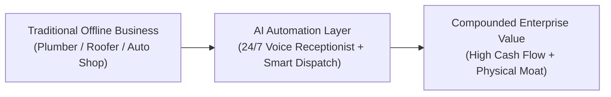

# Context 01: Atoms (Physical Businesses & Real-World Operations)

**Source Reference:** [Video #32 Master Analysis](./32_Master_Video_Analysis_8_Businesses_AI_Age.md)  
**Creator:** Greg Isenberg | **Category:** Real-World Infrastructure & Service Arbitrage  
**Beginner Viability Score:** **6.0 / 10** | **AI Defensibility:** **10 / 10 (Untouchable)** 🛡️

---

## 1. Executive Summary & Core Mechanism
While software products ("pixel businesses") can be reverse-engineered or generated by AI in seconds, physical operations ("atom businesses") require physical presence, manual dexterity, local equipment, and physical real estate. 

AI cannot fix a broken sewer line, pour foundation concrete, install a central AC compressor, or brew an artisanal cappuccino. As a result, capital from the tech sector is flowing into "boring" physical businesses. The real opportunity for an AI builder is **not** to become a plumber—it is to **modernize offline operators using autonomous AI operations**.

---

## 2. The Money Math & Economic Reality
### The Valuation Arbitrage
- **Pure Software Multiple Compression:** Pre-AI, micro-SaaS companies sold for 5x–10x ARR. With barriers collapsing, generic software multiples are sliding to 2x–4x SDE.
- **Physical Service Businesses:** Traditional local trade businesses trade at **2.5x to 4x SDE (Seller's Discretionary Earnings)**, but boast 25%–40% net profit margins.
- **The Modernization Multiplier:**
  - An average independent HVAC operator does $1.2M in gross revenue with $300k net profit.
  - Due to missed inbound calls (30% of incoming customer calls go to voicemail after 5 PM), they lose ~$150k/year in high-ticket replacements.
  - Adding an AI agent phone receptionist (Retell AI / Vapi) captures an extra 10–15 jobs/month ($5,000 avg job size) = **+$600k in top-line revenue** with near-zero added labor.

---

## 3. How a Solo / AI Practitioner Plays This Model
You do not need $500k to buy a plumbing company. There are two primary entry paths:

### Model A: The Equity / Revenue-Share JV (Zero Capital)
1. Approach established local trade businesses doing $500k–$2M/year with retiring owners (Boomer generation).
2. Propose a modern growth partnership: You deploy full digital infrastructure (AI voice agents, automated SMS follow-ups, Google Maps ranking, online booking).
3. Negotiate **15% to 25% of all new revenue generated** or an equity vesting stake.

### Model B: The "Search Fund" or SMB Acquisition
1. Acquire a business using SBA 7(a) financing (10% down, 90% debt).
2. Replace obsolete administrative staff with AI agents for scheduling, inventory, and customer service.
3. Boost profit margins from 15% to 35% in month 6.

---

## 4. Required Tech Stack & Architecture
- **Inbound AI Voice Receptionist:** Retell AI / Vapi.ai + Twilio (handles calls, answers FAQ, books calendar slots).
- **CRM & Dispatch:** ServiceTitan, Jobber, or GoHighLevel.
- **Automated Review Engine:** Make.com webhook sending SMS review links immediately upon invoice payment.
- **Local SEO Automation:** Google Business Profile API + automated weekly geo-tagged updates.

---

## 5. AI Defensibility Analysis
- **Barrier to Entry:** Extremely High (physical licensing, trucks, real-world tools, local reputation).
- **AI Vulnerability:** **0%** for field work, **90%** for back-office admin.
- **Long-Term Moat:** The physical assets and customer goodwill are immune to LLM commoditization.

---

## 6. Pros vs Cons
| Pros | Cons |
| :--- | :--- |
| Immediate high cash flow from Day 1 | Requires in-person presence or local management |
| Near-zero risk of an AI startup killing your core service | High liability, insurance requirements, and physical equipment |
| Non-technical local competition is easy to outperform | Capital or sales skill required to negotiate with owners |

---

## 7. 7-Day Fast Cash Execution Sprint
- **Day 1–2:** Call 20 local HVAC/roofing businesses after 6:00 PM. Record how many go to voicemail (usually 14+).
- **Day 3:** Build a 60-second Retell AI demo agent customized with the company's name and services.
- **Day 4:** Walk into the owner's office or send an async Loom video showing their missed revenue.
- **Day 5–7:** Close a pilot: *"I'll install this AI receptionist for free for 7 days. If it captures 2 jobs you would have lost, you pay $1,500/month."*
