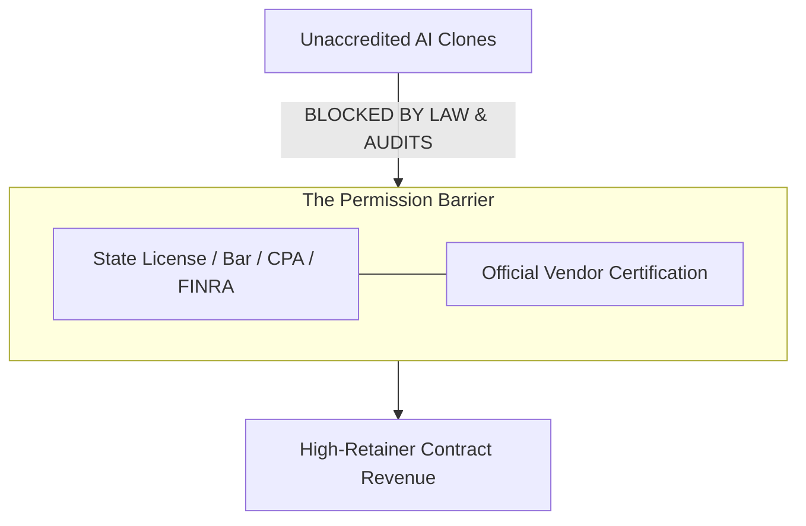

# Context 02: Permission (Licenses, Regulation & Strategic Partnerships)

**Source Reference:** [Video #32 Master Analysis](./32_Master_Video_Analysis_8_Businesses_AI_Age.md)  
**Creator:** Greg Isenberg | **Category:** Regulatory Arbitrage & Certified Vendor Moats  
**Beginner Viability Score:** **4.0 / 10** | **AI Defensibility:** **9.5 / 10 (Bulletproof)** 🛡️

---

## 1. Executive Summary & Core Mechanism
"Permission" businesses are protected by legal, regulatory, or institutional barriers that cannot be bypassed with software. Anyone can write code, but you cannot legally practice corporate tax law, audit public companies, write insurance policies, or issue medical prescriptions without certified accreditation, state licenses, and compliance clearances.

Furthermore, permission extends to **strategic enterprise partner programs** (e.g., Salesforce Certified Partner, Microsoft Solutions Partner, HubSpot Tier-1, Shopify Plus Certified). Once an enterprise designates a company as a "preferred vendor," prospective clients choose them by default to avoid corporate liability.



---

## 2. The Money Math & Economic Reality
### Why "Permission" Protects Pricing Power
- In unregulated digital services, prices race to the bottom as AI lowers entry barriers.
- In regulated sectors, compliance costs create artificial scarcity:
  - Corporate legal compliance audit: **$15,000 – $50,000 flat**
  - Enterprise ERP implementation (SAP/Salesforce/Workday): **$100,000 – $500,000+**
  - Specialized CPA audit & tax restructuring: **$3,000 – $10,000/month**
- **The Partnership Arbitrage:** A licensed professional usually lacks modern AI automation and outbound client acquisition skills. An AI-savvy practitioner can partner with a single accredited CPA or attorney to generate $200k+/year in automated advisory services.

---

## 3. How a Solo / AI Practitioner Plays This Model Without a License
You don't need to attend law school or spend 5 years studying for a CPA exam. You have two viable strategies:

### Strategy 1: The Licensed Joint Venture (The "50/50 Flywheel")
1. **Find Licensed Specialists:** Connect with solo attorneys, boutique CPA firms, or independent insurance adjusters who are struggling to find clients.
2. **The Division of Labor:**
   - **Your Side:** Build the client acquisition funnel, run AI document analysis workflows (Claude/NotebookLM), and automate initial client intake forms.
   - **Their Side:** Review the output, apply their professional license seal/stamp, and handle official filings.
3. **Economics:** Split fees 50/50. You provide 100% of the growth and back-office speed; they provide 100% of the legal permission.

### Strategy 2: Enterprise Ecosystem "Preferred Vendor" Fast-Track
- Rather than pitching "generic AI services," get certified in a high-demand enterprise software ecosystem (e.g., Salesforce Agentforce, ServiceNow, Databricks, Snowflake).
- Enterprise buyers refuse to hire random freelancers—they only search the official Partner Directory.
- Passing 2–3 vendor certification exams grants access to inbound enterprise RFP leads where contract minimums start at $10k–$25k.

---

## 4. Required Tools & Software Stack
- **Enterprise Partner Hubs:** Salesforce Partner Community, Microsoft AI Cloud Partner Program, HubSpot Solutions Partner.
- **Compliance & Document Processing:** Claude 3.5 Sonnet / GPT-4o with retrieval-augmented generation (RAG) for statutory legal/tax document extraction.
- **Contract & Escrow Management:** PandaDoc, DocuSign, Stripe Billing.

---

## 5. Beginner ("Noob") Reality Check
| Metric | Rating | Notes |
| :--- | :---: | :--- |
| **Capital Needed** | Low ($500–$2,000 for exam fees/licensing fees) | Minimal upfront cost for certification path |
| **Technical Barrier** | 7 / 10 | Must understand enterprise compliance and industry rules |
| **Time to First $** | 60 – 90 Days | Vetting, credential verification, and corporate sales cycles take time |
| **Long-Term Moat** | **9.5 / 10** | Massive legal defensibility; impossible for overnight startups to copy |

### Pitfalls & Hidden Traps:
- **Legal Compliance:** Never attempt to practice without the licensed partner's formal sign-off. The unauthorized practice of law/accounting carries severe civil and criminal penalties.
- **Bureaucracy:** Partner directories have strict application criteria and periodic review cycles.

---

## 6. Action Plan for a Complete Beginner
```markdown
Day 1-5: Research the top 3 partner certification programs in high demand (e.g., Salesforce Agentforce, HubSpot CRM, Zapier Certified Expert).
Day 6-15: Complete the introductory certification modules and pass the primary assessment.
Day 16-20: Reach out to 10 certified boutique professionals (CPAs or niche lawyers) on LinkedIn.
Day 21-25: Pitch the JV model: "You do the licensed review; I build an AI intake system that brings 5 high-ticket corporate clients this month."
Day 26-30: Secure 1 joint-venture agreement with a 40-50% revenue share contract.
```
