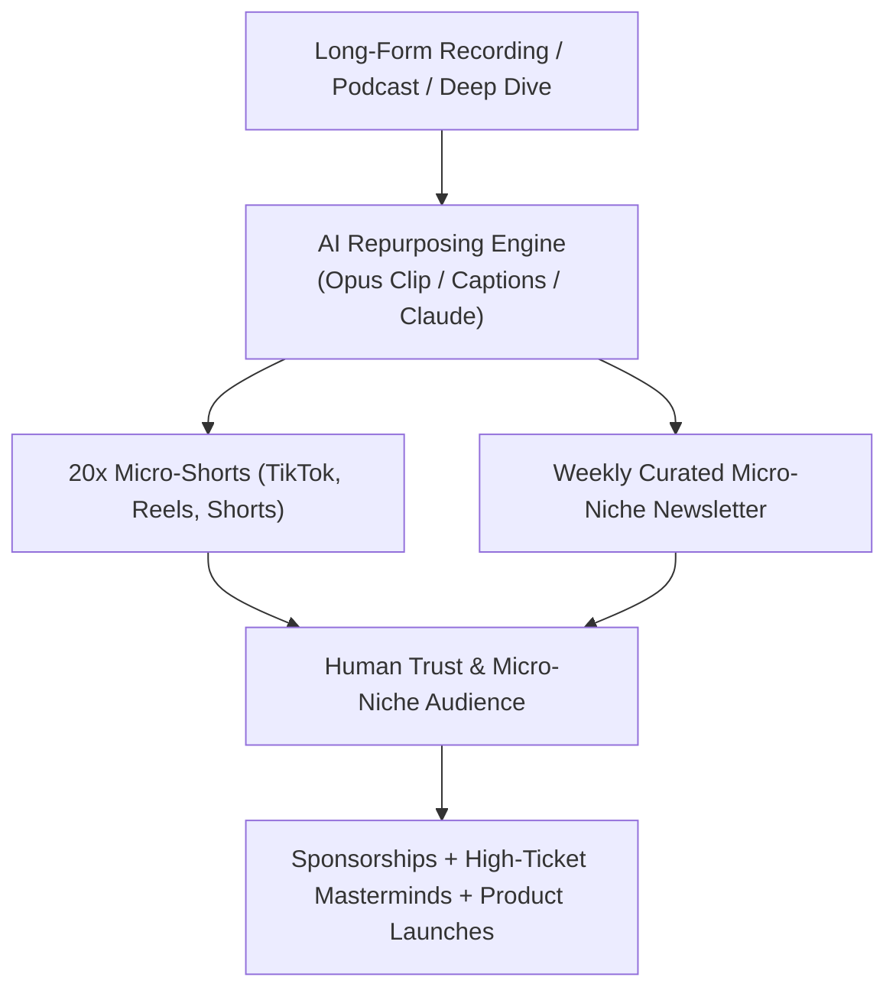

# Context 03: Attention (Micro-Niche Media Machines & Distribution Moats)

**Source Reference:** [Video #32 Master Analysis](./32_Master_Video_Analysis_8_Businesses_AI_Age.md)  
**Creator:** Greg Isenberg | **Category:** Media Engines, Content Arbitrage & Distribution Moats  
**Beginner Viability Score:** **8.5 / 10** | **AI Defensibility:** **8.5 / 10 (High Moat)** 🛡️

---

## 1. Executive Summary & Core Mechanism
As AI makes code and software commoditized, **distribution is king**. When anyone can build an app in a weekend, the only question that matters is: *Who has the audience and trust to sell it to?*

Greg Isenberg emphasizes that **attention is deeply underrated**. While generic AI-generated "slop" is flooding social feeds, authentic human curation, point of view, and micro-niche media machines have never been more valuable. People follow people—not anonymous corporations. By leveraging AI editing tools (like Opus Clip, Claude, Descript), a single solo creator can now output the volume of a 10-person media house in under 5 hours per week.



---

## 2. The Money Math & Economic Reality
### The Micro-Niche Newsletter & Media Model
You do not need 1,000,000 generic followers on TikTok to make serious money. In B2B and passionate micro-niches, audience value is concentrated:
- **Broad Entertainment RPM:** $1 – $3 per 1,000 views.
- **High-Value B2B Micro-Niche (e.g., HVAC owners, Commercial Real Estate, Biohacking):**
  - **Newsletter CPM (Sponsors):** $50 – $120 per 1,000 subscribers.
  - A newsletter with **5,000 active readers** in a B2B vertical running 2 sponsor slots per weekly edition:
    $$\text{5,000 readers} \times \$80\text{ CPM} = \$400\text{ per sponsor slot}$$
    $$\$400 \times 2\text{ slots} \times 4\text{ weeks} = \mathbf{\$3,200/\text{month}}\text{ from sponsorships alone.}$$
- **Direct Backend Monetization:**
  - Converting just **1%** (50 subscribers) into a **$99/month private membership community** (Context 5) adds **$4,950/month in pure recurring profit**.

---

## 3. How to Build a Micro-Niche Media Machine (Step-by-Step)

### Step 1: Pick an Underserved "Boring" Micro-Niche
Avoid saturated niches like "general self-improvement" or "generic crypto news." Target specific verticals:
- Operations tech for dental clinics
- AI tools specifically for civil engineers
- Logistics & warehousing automation
- Estate planning for high-net-worth families

### Step 2: Set Up the AI Media Factory
- Record 1 core long-form asset per week (a 20-minute video analysis, interview, or teardown).
- Drop the video file into **Opus Clip** (or Opus 5.5) $\rightarrow$ automatically extracts the 5 most viral clips, auto-captions, re-frames 9:16, and generates hooks.
- Feed the transcript into **Claude 3.5 Sonnet** to extract:
  - 1 weekly deep-dive newsletter edition (beehiiv / Substack)
  - 5 high-engagement LinkedIn / X text posts
  - 3 thread summaries

### Step 3: Distribution & Traffic Capture
- Post 2 clips/day across YouTube Shorts, Instagram Reels, and LinkedIn.
- In every profile bio and pinned comment, offer a free high-value operational asset (e.g., "The Complete 2027 Equipment Checklist") to capture email addresses.

---

## 4. Required Tools & Software Stack
- **AI Video Clipping:** Opus Clip, Submagic, Descript.
- **Newsletter & Email CRM:** beehiiv, Substack, Kit (formerly ConvertKit).
- **Text & Script Generation:** Claude 3.5 Sonnet, ChatGPT.
- **Visual Design:** Canva, Figma, Midjourney (for newsletter headers).

---

## 5. Beginner ("Noob") Reality Check
| Metric | Rating | Notes |
| :--- | :---: | :--- |
| **Capital Needed** | **$0** (Free tiers available for all core tools) | Lowest capital requirement of all models |
| **Technical Barrier** | 2 / 10 | Extremely beginner-friendly |
| **Time to First $** | 30 – 60 Days | Takes a few weeks of consistent posting to build baseline trust |
| **Long-Term Moat** | **8.5 / 10** | A loyal audience that trusts your name is an asset no algorithm can strip away |

### Pitfalls & Hidden Traps:
- **Faceless vs. Personality:** While faceless theme pages work, personal brand / founder-led media has 5x higher loyalty and 10x higher enterprise exit multiples.
- **Shiny Object Syndrome:** Switching niches every two weeks resets your compounding momentum. Stick to one micro-niche for at least 90 days.

---

## 6. Action Plan for a Complete Beginner
```markdown
Day 1: Choose 1 specific B2B micro-niche and establish a clean account on beehiiv and LinkedIn/X.
Day 2-3: Research the top 10 unanswered questions in Reddit communities for that niche.
Day 4: Record a 15-minute screen recording breaking down solutions to those 10 questions.
Day 5: Run the video through Opus Clip to generate 7 viral short clips.
Day 6: Format the transcript into a 1,000-word beehiiv newsletter post.
Day 7: Schedule 1 post daily for the upcoming week and link to your newsletter signup.
```
