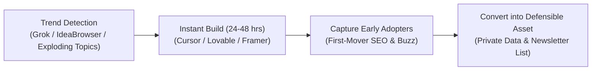

# Context 04: Timing (Trend Arbitrage & First-Mover Advantage)

**Source Reference:** [Video #32 Master Analysis](./32_Master_Video_Analysis_8_Businesses_AI_Age.md)  
**Creator:** Greg Isenberg | **Category:** Trend Arbitrage, Speed-to-Market & Early Wave Riding  
**Beginner Viability Score:** **7.5 / 10** | **AI Defensibility:** **6.0 / 10 (High Speed, Lower Moat)** ⚡

---

## 1. Executive Summary & Core Mechanism
In traditional business cycles, spotting a consumer or enterprise trend early meant months of design, manufacturing, or software engineering before launching a product. By that time, competitors had arrived and the wave had passed.

In the AI age, **execution speed is practically instantaneous**. With tools like Cursor, Claude, Grok, and no-code app builders, you can spot a breakout micro-trend on Monday morning and deploy a live, monetized solution by Tuesday night. Greg Isenberg notes: *"Sometimes I am shocked when you're early on a trend, how few people have actually gone and built something for those people."*

While the initial product might not be AI-proof, **the early customer data, backlinks, brand awareness, and email lists you collect ARE completely AI-proof**.



---

## 2. The Money Math & Economic Reality
### The "First-Mover Rush" Economics
- Being the first dedicated resource in an emerging category gives you massive organic SEO dominance and PR coverage for near-zero ad spend.
- **Example 1: Micro-Directory or Tool:**
  - Launching the first curated directory of "AI Voice Agents for Dental Clinics" when the trend emerges.
  - 15,000 monthly visits within 60 days due to zero keyword competition.
  - Charging 30 featured tool providers **$199/month** to be pinned at the top:
    $$30 \times \$199 = \mathbf{\$5,970/\text{month}}\text{ in passive listing revenue.}$$
- **Example 2: Trend-Driven Digital Products:**
  - Creating the definitive operating kit or workflow blueprint for a new AI framework (e.g., Apple Intelligence integration guide or Grok 3 prompt engine).
  - Selling 200 copies at $47 in the first 2 weeks = **$9,400 in quick capital**.

---

## 3. How to Set Up an Autonomous Trend-Monitoring Engine

### Step 1: Autonomous Trend Listening
Do not rely on guessing. Set up automated monitors across four high-signal platforms:
- **IdeaBrowser / Exploding Topics / Glimpse:** Tracks search volume hockey-stick spikes.
- **X (Twitter) Advanced Search via Grok:** Monitor queries like `"why is there no tool for [industry]"` or `"looking for an alternative to [service]"`.
- **GitHub Trending Repositories:** Spot early developer infrastructure gaining 1,000+ stars overnight.
- **Reddit / HackerNews Trend Trackers:** Search for pain points in niche subreddits (r/smallbusiness, r/ecommerce).

### Step 2: Rapid Productization (The 48-Hour Sprint)
When a clear spike is confirmed:
1. **Hour 0–12:** Define the minimum valuable deliverable (a curated resource directory, a specialized template, or a focused single-feature micro-app).
2. **Hour 12–36:** Build the interface using **Lovable.dev**, **v0.dev**, or **Cursor** + Tailwind.
3. **Hour 36–48:** Launch on Product Hunt, HackerNews, and Reddit with a "First-Look" campaign.

### Step 3: The Moat Conversion (Crucial Step)
- Do not let the traffic vanish when the trend normalizes.
- Force an email capture or community invitation (Context 5) on all downloads/signups.
- By the time copycats arrive 3 months later, you already own a 10,000-person engaged audience and proprietary market feedback.

---

## 4. Required Tools & Software Stack
- **Trend Intelligence:** IdeaBrowser.com, Exploding Topics, Google Trends API, Grok (X).
- **Rapid App/Site Prototyping:** Lovable.dev, v0 by Vercel, Cursor, Framer.
- **Distribution & Launch:** Product Hunt, X (Twitter), Reddit, LinkedIn.
- **Email Capture:** Kit, beehiiv, Resend.

---

## 5. Beginner ("Noob") Reality Check
| Metric | Rating | Notes |
| :--- | :---: | :--- |
| **Capital Needed** | Low ($0 – $50 for domain & hosting) | Extremely inexpensive to test multiple ideas |
| **Technical Barrier** | 4 / 10 | Assisted by modern AI coding generators (v0 / Lovable) |
| **Time to First $** | **7 – 14 Days** | Quickest validation cycle of any digital model |
| **Long-Term Moat** | 6 / 10 | Must convert the early attention into community or proprietary data |

### Pitfalls & Hidden Traps:
- **Falling in love with the feature:** Trends fade. If interest wanes, do not waste 6 months refactoring code. Milk the cash flow, capture the emails, and pivot to the next wave.
- **Late entry:** If you see 15 YouTube tutorials already covering the exact trend, you are late. Move to adjacent unaddressed niches.

---

## 6. Action Plan for a Complete Beginner
```markdown
Day 1: Monitor Exploding Topics and Grok to identify 3 emerging technology or industry trends.
Day 2: Select 1 clear trend with high search growth and zero dedicated productized tools.
Day 3: Use v0.dev or Cursor to build a clean 1-page directory or diagnostic tool solving that pain.
Day 4: Embed a free checklist download that captures user email addresses.
Day 5: Share the tool on relevant subreddits and X threads where people are discussing the problem.
Day 6-7: Add an affiliate link or $49/mo "Featured Listing" slot to generate first revenue.
```
