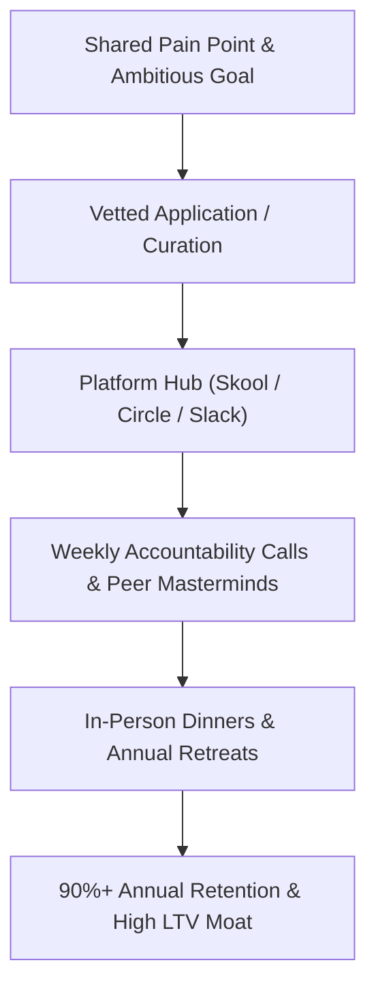

# Context 05: Belonging (Paid Communities & In-Real-Life Events)

**Source Reference:** [Video #32 Master Analysis](./32_Master_Video_Analysis_8_Businesses_AI_Age.md)  
**Creator:** Greg Isenberg | **Category:** Community Architecture, Human Connection & Masterminds  
**Beginner Viability Score:** **9.0 / 10** 🥈 | **AI Defensibility:** **9.5 / 10 (Impenetrable Moat)** 🛡️

---

## 1. Executive Summary & Core Mechanism
As digital feeds become dominated by AI personas, synthetic content, and automated bots, genuine human-to-human connection has become the supreme luxury good. People are more digitally connected than ever before, yet report unprecedented levels of loneliness and disconnection.

Greg Isenberg emphasizes that **Belonging is an AI-proof superpower**. AI can give you accurate answers, but an LLM cannot offer empathy, high-stakes peer accountability, shared celebration of a milestone, or the electric energy of an in-person dinner with founders who understand your exact struggles. Businesses built around curated membership, shared status, and IRL (In-Real-Life) events are commanding massive pricing power and near-zero churn.



---

## 2. The Money Math & Economic Reality
### The Recurring Membership Math
Communities hosted on platforms like Skool or Circle operate with **90%+ net profit margins** because there is no inventory, no cloud compute overhead, and users generate the majority of value through peer interaction.

#### Model 1: The Micro-Niche Skool Community ($99/mo)
- **Target Size:** 150 dedicated members in a specific field (e.g., "Agency Founders Transitioning to AI Automations").
- **Monthly Revenue:** $150 \times \$99 = \mathbf{\$14,850/\text{month}}$ ($178,200/year).
- **Time Commitment:** ~4 hours per week (hosting 1 weekly group coaching/accountability call and moderating discussions).

#### Model 2: The "Hampton" High-Ticket Mastermind ($8,500/year)
- Greg cites Sam Parr's company **Hampton** (an invitation-only community for founders generating over $3M/year).
- What makes Hampton work is not complex software—it is **curation and confidentiality**.
- Curating just **30 vetted high-earning members** into a tight-knit peer group:
  $$30 \times \$8,500 = \mathbf{\$255,000/\text{year}}\text{ recurring.}$$
- Organizing 2 exclusive weekend retreats per year (funded out of membership dues) creates lifelong bonds that members never cancel.

---

## 3. How to Launch a Paid Community from Scratch (Step-by-Step)

### Step 1: Define the "Transformation Goal"
A community is not a generic chatroom. People pay for **speed to a specific transformation**.
- *Weak:* "A community for people interested in AI." (Nobody pays for this).
- *Strong:* "A vetted cohort of boutique accounting firm owners implementing autonomous bookkeeping agents to add $50k in profit this quarter."

### Step 2: Establish the 3 Core Pillars
1. **Curated Peer Matching:** Group members into 4–6 person "accountability pods" that meet bi-weekly.
2. **Weekly Hot-Seat Call:** Host a 60-minute Zoom call where 2 members get their systems audited live.
3. **Proprietary Asset Vault:** Provide plug-and-play templates, workflows, and contracts that can't be found anywhere else.

### Step 3: Layering the IRL (In-Real-Life) Spark
- Software cannot match breaking bread together.
- Host quarterly regional dinners (rent a private dining room in Austin, London, or New York for 15 members).
- Greg notes that their recent agent-building event in Nashville had massive unmet demand because founders were desperate to meet peers in person.

---

## 4. Required Tools & Software Stack
- **Community Platforms:** Skool (best for gamification & courses), Circle.so (best for white-label brand feel), Whop.
- **Live Calls:** Zoom, Luma (lu.ma) for event ticketing & calendar management.
- **Billing & Subscriptions:** Stripe, Whop payments.
- **Application Filtering:** Typeform or Tally (to vet members before allowing payment).

---

## 5. Beginner ("Noob") Reality Check
| Metric | Rating | Notes |
| :--- | :---: | :--- |
| **Capital Needed** | **$0 – $99** (Skool subscription) | Virtually zero startup cost |
| **Technical Barrier** | **1 / 10** | Zero code required; purely relational and organizational |
| **Time to First $** | **14 – 21 Days** | Can presell an initial 10-person founding member cohort |
| **Long-Term Moat** | **9.5 / 10** | Member-to-member relationships make switching costs astronomically high |

### Pitfalls & Hidden Traps:
- **The "Ghost Town" Hazard:** If you don't actively curate discussions in the first 60 days, members stop checking the app and churn.
- **Selling Access instead of Outcomes:** Always frame membership around achieving a milestone together rather than "paying to chat with me."

---

## 6. Action Plan for a Complete Beginner
```markdown
Day 1: Identify 1 specific professional group with high willingness to pay (e.g., solo recruiters, independent consultants).
Day 2: Set up a free application form on Tally with 5 qualifying questions (revenue, current bottleneck, commitment).
Day 3-5: Reach out personally to 30 people matching this profile on LinkedIn: "Launching a private 15-person peer mastermind focused on [Outcome]."
Day 6-7: Presell 10 founding member seats at $79/month or $500/year before setting up the platform.
Day 8-10: Launch the Skool/Circle space, schedule the first kickoff Zoom, and introduce the members to their pods.
```
