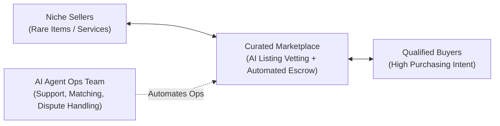

# Context 06: Liquidity (AI-Driven Niche Marketplaces)

**Source Reference:** [Video #32 Master Analysis](./32_Master_Video_Analysis_8_Businesses_AI_Age.md)  
**Creator:** Greg Isenberg | **Category:** Two-Sided Network Effects & Platform Liquidity  
**Beginner Viability Score:** **5.0 / 10** | **AI Defensibility:** **9.0 / 10 (Massive Moat)** 🛡️

---

## 1. Executive Summary & Core Mechanism
When people claim *"software is dead,"* they are confusing single-player tools with **multi-player network platforms**. A standalone software feature can be duplicated by an AI agent in minutes. However, a **marketplace with liquid buyers and sellers** cannot be cloned overnight because its value resides in the active network of participants, not the code.

Greg highlights examples like Doug DeMuro's **Cars & Bids** (acquired for tens of millions) and his friend's recently launched **FinalApp.com** (curated marketplace for high-end collectible cars). 

Historically, running a marketplace required huge human teams for customer service, dispute resolution, trust & safety, and manual listing review. In 2026/2027, **autonomous AI agents can manage 80% of marketplace operations**, allowing a 1-to-3 person team to run a platform processing millions of dollars in Gross Merchandise Value (GMV).



---

## 2. The Money Math & Economic Reality
### Marketplace Take-Rate Economics
Marketplaces monetize via a **take-rate** (a percentage cut of every completed transaction between buyer and seller):
- Typical transaction take-rate: **5% to 15%** (often split between buyer fee and seller fee).
- **The Micro-Niche Marketplace Model:**
  - Niche: High-end vintage espresso machines, specialized laboratory equipment, or rare designer watches.
  - Average transaction price: **$3,500**
  - Transactions per month: **100**
  - Monthly Gross Merchandise Value (GMV): **$350,000**
  - **10% Marketplace Take-Rate:**
    $$\$350,000 \times 10\% = \mathbf{\$35,000/\text{month}}\text{ in high-margin gross revenue.}$$
- **Operational Cost Reduction:** Pre-AI, handling 100 high-ticket disputes/inspections required 4 full-time support staff ($20,000/mo). With AI agents handling automated listing moderation and tier-1 disputes, your overhead is under $1,000/mo.

---

## 3. How a Lean Founder Solves the "Chicken-and-Egg" Problem

The hardest part of any marketplace is having enough sellers to attract buyers, and enough buyers to retain sellers. Greg suggests two modern AI-enabled playbooks:

### Playbook A: The Audience / Creator Joint Venture
1. Don't build a marketplace in an industry where you have zero audience.
2. Find a niche creator or media brand (e.g., an Instagram page with 150k followers dedicated to vintage Japanese guitars).
3. Partner with them: You build and manage the AI-driven marketplace technology; they supply 100% of the initial buyers and sellers via their social channels.
4. Split transaction fee profits 50/50.

### Playbook B: Supply Subsidization via AI Scrapers
1. In the first 30 days, populate the marketplace with the best available listings across the web (with sellers' explicit permission).
2. Use an AI agent to monitor Facebook Marketplace, Craigslist, and niche forums to identify motivated sellers.
3. Reach out with an automated offer: *"We have verified collectors looking for this specific item; we will feature your listing for 0% seller fees if you list with us."*

---

## 4. Required Tools & Software Stack
- **No-Code Marketplace Engines:** Sharetribe, Bubble, MedusaJS (for headless custom control).
- **Listing Automation & Verification:** Claude 3.5 Sonnet API (for image inspection, specification extraction, and fraud scoring).
- **Automated Customer Care:** Intercom / Zendesk integrated with AI agent resolution bots (Fin AI / custom Claude Code webhooks).
- **Escrow & Payments:** Stripe Connect (handles multi-party split payments and automatic 1099/KYC verification).

---

## 5. Beginner ("Noob") Reality Check
| Metric | Rating | Notes |
| :--- | :---: | :--- |
| **Capital Needed** | Moderate ($500 – $2,500 for tooling & initial escrow) | Moderate technical setup required |
| **Technical Barrier** | 7 / 10 | Must configure two-sided databases and Stripe Connect payouts |
| **Time to First $** | 60 – 90 Days | Requires establishing critical liquidity mass before first transaction |
| **Long-Term Moat** | **9.0 / 10** | Once liquidity is achieved, network effects create a multi-million-dollar barrier |

### Pitfalls & Hidden Traps:
- **Broad Niches:** Never try to build "an alternative to eBay or Upwork." Target hyper-specific micro-categories (e.g., used certified flight simulator components).
- **Disintermediation:** Prevent buyers and sellers from taking transactions offline by offering built-in escrow guarantees, insured shipping, and buyer purchase protection.

---

## 6. Action Plan for a Complete Beginner
```markdown
Day 1-3: Identify 1 underserved passionate collector or B2B niche with transactions over $1,000.
Day 4-7: Partner with a niche creator who has an audience in this space or build an initial waitlist.
Day 8-15: Deploy a clean, responsive marketplace using Sharetribe or Bubble with Stripe Connect.
Day 16-20: Seed the platform with 25 hand-curated exclusive listings from trusted sellers.
Day 21-30: Run an inaugural "Drop Week" where only 5 featured items are auctioned to create FOMO and liquidity.
```
