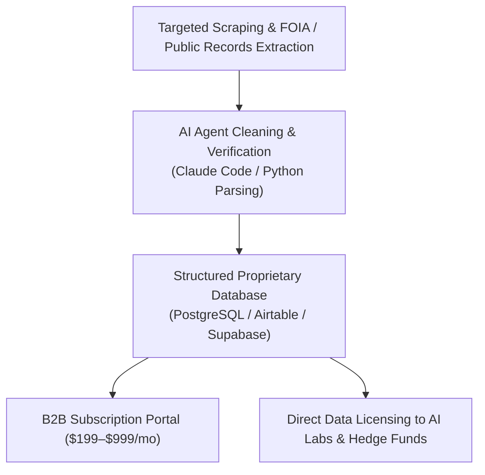

# Context 07: Unique Data (Proprietary Databases & Data Brokering)

**Source Reference:** [Video #32 Master Analysis](./32_Master_Video_Analysis_8_Businesses_AI_Age.md)  
**Creator:** Greg Isenberg | **Category:** Data Arbitrage, Curated Directories & Proprietary Intelligence  
**Beginner Viability Score:** **7.5 / 10** | **AI Defensibility:** **9.0 / 10 (High Technical Moat)** 🛡️

---

## 1. Executive Summary & Core Mechanism
The foundation of every AI model is training data. However, the world's frontier AI labs (OpenAI, Anthropic, Google) and enterprise algorithms have effectively scraped the entire public internet. Public Wikipedia, Reddit, and common websites are already exhausted.

As a result, **proprietary, clean, domain-specific data is the new oil**. Greg points out that data brokers and curated database creators are making millions of dollars a week. If you can aggregate, verify, and structure closed-loop data that a generic web scraper cannot find or parse, you possess an asset that:
1. Enterprise customers will pay recurring subscriptions to access.
2. Frontier AI labs will pay 5-to-6-figure licensing checks to ingest.



---

## 2. The Money Math & Economic Reality
### Two Parallel Monetization Streams

#### Stream 1: The B2B Subscription Directory ($299/mo)
- **Target Audience:** Sales teams, private equity analysts, recruiters, or specialized contractors looking for high-intent leads.
- **Example:** A database tracking every local commercial warehouse lease expiration, zoning permit change, or liquor license application across 50 major metro areas.
- **Subscriber Economics:**
  - 100 commercial real estate brokers or equipment suppliers at **$299/month**:
    $$100 \times \$299 = \mathbf{\$29,900/\text{month}}\text{ (\$358,800/year ARR).}$$
  - Churn is virtually zero because your dataset directly produces deals for their pipeline.

#### Stream 2: Bulk Data Licensing to AI Labs & Institutional Funds
- AI companies constantly buy verified specialized data (e.g., paired domain reasoning, medical billing audits, multilingual regional trade contracts) to fine-tune specialized models.
- Single dataset licensing agreements routinely close between **$25,000 and $150,000 flat**, with annual refresh rights.

---

## 3. How to Build a Proprietary Data Engine (Step-by-Step)

### Step 1: Find Data That Resides "Behind Friction"
Avoid data that is already indexable on Google. Look for information that requires work to compile:
- Municipal government PDF records, county clerk filings, local court proceedings.
- Freedom of Information Act (FOIA) public data dumps that are messy and unstructured.
- Proprietary industry benchmarks gathered via anonymous community surveys (Context 5).
- Directory of unlisted specialized suppliers (e.g., manufacturers of precision optical lenses in Southeast Asia).

### Step 2: Use AI to Clean, Standardize & Enrich
- Raw data is dirty. Write a simple Python script or use Claude Code to parse PDF tables, standardize phone numbers, verify corporate emails via Hunter/NeverBounce, and normalize addresses.
- Store the clean records in **Supabase** or **Airtable**.

### Step 3: Package & Gate the Asset
- Build a front-end search directory using **Softr**, **Framer**, or **Next.js**.
- Gate full data fields (direct phone numbers, historical pricing, contact names) behind a Stripe subscription paywall.

---

## 4. Required Tools & Software Stack
- **Data Scraping & Extraction:** Apify, Playwright, Octoparse, Python (BeautifulSoup).
- **Data Cleaning & Standardization:** Claude 3.5 Sonnet (for unstructured PDF/document entity extraction).
- **Database & Backend:** Supabase, PostgreSQL, Airtable.
- **Frontend Portal:** Softr (instant Airtable/Supabase portal), Outseta (all-in-one auth, billing & CRM).

---

## 5. Beginner ("Noob") Reality Check
| Metric | Rating | Notes |
| :--- | :---: | :--- |
| **Capital Needed** | Low ($50 – $200 for scraping proxies and database tiers) | Minimal capital required |
| **Technical Barrier** | 5 / 10 | Basic understanding of scraping, JSON/CSV, and simple databases |
| **Time to First $** | 21 – 45 Days | Requires compiling a baseline dataset of at least 1,000–5,000 records |
| **Long-Term Moat** | **9.0 / 10** | High defensibility; LLMs cannot hallucinate verifiable private phone numbers or permits |

### Pitfalls & Hidden Traps:
- **Compliance & Legal:** Ensure you only aggregate publicly available records, compliant B2B contacts, or self-reported data. Never scrape copyrighted private consumer data.
- **Data Decay:** Data rots quickly (people change jobs, businesses close). Build automated monthly validation scripts to maintain high fidelity.

---

## 6. Action Plan for a Complete Beginner
```markdown
Day 1: Identify 1 local government or industry source with high-value PDF filings (e.g., commercial building permits).
Day 2-3: Write a Python script or use Apify to extract the last 12 months of records.
Day 4-5: Run the messy text through Claude to standardize into clean columns (Company, Address, Project Value, Contact).
Day 6-7: Connect the database to a Softr front-end with search filters.
Day 8-10: Reach out to 25 local subcontractors (electricians, drywallers, roofers): "Here are all 50 commercial permits approved this week."
Day 11-14: Offer them weekly automated alerts for $149/month; close your first 3 subscribers.
```
