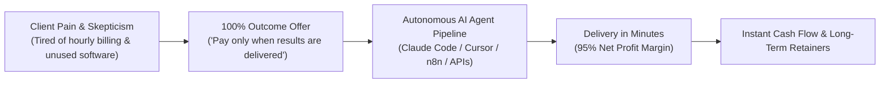

# Context 08: Outcomes (Outcome-Based AI Agencies & Automated Services)

**Source Reference:** [Video #32 Master Analysis](./32_Master_Video_Analysis_8_Businesses_AI_Age.md)  
**Creator:** Greg Isenberg | **Category:** Productized Services, Agentic Automation & Risk-Reversal Selling  
**Beginner Viability Score:** **9.5 / 10** 🏆 (Fastest Path to Cash) | **AI Defensibility:** **7.5 / 10** ⚡

---

## 1. Executive Summary & Core Mechanism
The traditional agency model (billing by the hour) and the traditional SaaS model (charging $49/month for software seats that clients never use) are both broken in the AI age. Clients are exhausted by paying software subscriptions that require their own time to learn, and they hate hourly agencies that inflate billing without guaranteeing tangible ROI.

**The "Outcomes" model is the ultimate risk reversal.** You do not sell software, and you do not bill for hours. You sell **guaranteed, measurable business results** (e.g., *"We install 15 qualified sales calls on your calendar"* or *"We migrate your entire legacy codebase to Next.js within 48 hours"*). 

Behind the scenes, you fulfill the entire deliverable in minutes using autonomous multi-agent pipelines (Claude Code, Cursor, n8n, Grok), giving you **95% profit margins** and **near-zero delivery labor**.



---

## 2. The Money Math & Economic Reality
### The Irresistible Risk-Reversal Pricing
When you eliminate buyer risk, conversion rates multiply 5x compared to standard agency pitches:

#### Example A: Pay-Per-Qualified-Lead / Meeting
- **Target:** B2B SaaS companies, commercial insurance brokers, boutique consulting firms.
- **Offer:** *"We only charge $250 per qualified executive meeting held. If they don't show up or don't match your criteria, you owe $0."*
- **Fulfillment:** You use an automated AI outreach engine (Instantly / Apollo + Claude personalization) that sends 1,500 targeted emails/week for ~$80 in operational cost.
- **Math:** 12 booked calls in month 1:
  $$12 \times \$250 = \mathbf{\$3,000}\text{ against } \$80\text{ in tool costs } = \mathbf{97.3\%\text{ Net Margin.}}$$

#### Example B: Productized Outcome Projects (Code & Migration)
- Greg highlights analyzing freelance platforms like **Upwork and Fiverr** to see what clients desperately post bounties for.
- A client posts: *"Need 200 CSV files parsed, validated, and loaded into Postgres database ($1,500 budget)."*
- A manual human freelancer bids 2 weeks of work.
- You use a Claude Code script to parse, clean, and validate all 200 CSVs in **12 minutes**.
- You deliver same-day and collect the full **$1,500**.

---

## 3. How to Build an Outcome-Based AI Service (Step-by-Step)

### Step 1: Identify High-Willingness-to-Pay Pain Points
Choose an outcome that directly ties to **more revenue** or **eliminated labor cost**:
- Generating qualified B2B booked discovery calls.
- Automated recruitment screening (filtering 500 applicant resumes into top 5 qualified candidates).
- Code migration / refactoring (converting PHP/Wordpress into modern static Jamstack).
- E-commerce ad creative generation (delivering 50 tested video variations per week).

### Step 2: Build the AI Fulfillment Agent Engine
Before pitching, assemble the fulfillment chain:
- **Claude Code / Cursor:** For data processing, code migrations, or file manipulation.
- **n8n / Make.com:** For multi-step API integrations (connecting incoming forms to databases and automated notifications).
- **HeyGen / ElevenLabs / Opus:** For high-volume automated creative assets.

### Step 3: The "No-Brainer" Spear Pitch
Reach out with pure outcome framing:
> *"Hey [Name], noticed your team is hiring a junior data entry specialist for $3,500/month. We have an autonomous AI workflow that will process all 50,000 monthly invoices with 99.9% accuracy for a flat $1,200/month. We will process your first 500 invoices completely free today so you can verify the results before paying a dime. Want me to send the test link?"*

---

## 4. Required Tools & Software Stack
- **AI Coding & Automation:** Claude Code CLI, Cursor, GitHub Copilot.
- **Workflow Orchestration:** n8n (self-hosted or cloud), Make.com.
- **B2B Outbound Infrastructure:** Instantly.ai, Smartlead, Apollo.io.
- **Contract & Billing:** Stripe Payment Links, Deel / Wise (for global client invoicing).

---

## 5. Beginner ("Noob") Reality Check
| Metric | Rating | Notes |
| :--- | :---: | :--- |
| **Capital Needed** | **$0** (Pay-as-you-go API credits & free trials) | The absolute cheapest entry point |
| **Technical Barrier** | **3 / 10** | Can be done with low-code (n8n) or modern conversational AI coding tools |
| **Time to First $** | **3 – 7 Days** 🚀 | Highest probability of immediate cash flow |
| **Long-Term Moat** | **7.5 / 10** | Requires continually improving agent workflows as base models advance |

### Pitfalls & Hidden Traps:
- **Scope Creep:** Never accept vague outcomes like *"make our marketing better."* Define unambiguous KPIs: *"Deliver 10 meetings with VPs of Engineering at Series A startups."*
- **Client Qualification:** Ensure the client has the capacity to fulfill the leads or results you provide; otherwise they stop paying.

---

## 6. Action Plan for a Complete Beginner
```markdown
Day 1: Browse Upwork / Fiverr for fixed-price job postings ($500–$2,000) that involve repetitive data, code, or content tasks.
Day 2: Test building an automated Python or n8n pipeline that completes the task in under 15 minutes.
Day 3: Submit 10 tailored proposals with a working video demo of the finished sample: "I have already processed 10% of your data as proof."
Day 4-5: Win your first contract, deliver the complete output within 24 hours, and collect 5-star feedback.
Day 6-7: Upsell the client on an ongoing monthly maintenance retainer ($500–$1,000/mo) to handle the task on autopilot.
```
