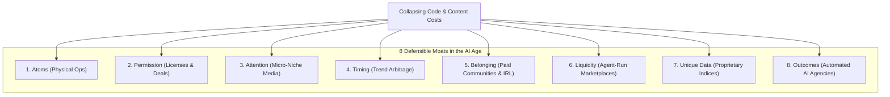

# Video #32 Analysis: 8 Businesses for the AI Age

## 1. Metadata & Source
- **Video Number:** 32 (Extended Master Series)
- **Title:** 8 Businesses for the AI Age
- **Channel / Creator:** Greg Isenberg (The Startup Ideas Podcast)
- **YouTube Link:** [https://youtu.be/b3tMAOFB71o](https://youtu.be/b3tMAOFB71o)
- **Primary Subject:** How to build defensible, "AI-proof" ventures when code, copy, and software creation costs collapse to zero.
- **Beginner Viability Score:** **8.5 / 10** (Ranges from instant $0-capital services to high-enterprise-value offline assets).

---

## 2. Executive Summary & The Core Thesis
As frontier AI labs (OpenAI, Anthropic, Google) advance, pure digital "pixel businesses" (generic SaaS, standard blog content, simple wrappers) face rapid commoditization and margin collapse. Anyone can clone a software tool or landing page in minutes.

Greg Isenberg outlines the **eight defensible moats ("Contexts")** that protect businesses from AI disruption. The core lesson is that enterprise value is moving away from the *creation of digital bits* toward **human trust, physical execution, legal exclusivity, network liquidity, proprietary data, and guaranteed outcomes**.

---

## 3. The 8 Business Contexts: Comprehensive Matrix

| Context # | Model Name | Primary Moat | Upfront Capital | Speed to 1st $ | Beginner Viability | 5-Year AI Defensibility |
| :-: | :--- | :--- | :---: | :---: | :---: | :---: |
| **01** | **[Atoms](./01_Context_Atoms_Physical_Businesses.md)** | Physical presence & manual trades | High / Med | Moderate | 6.0 / 10 | **10 / 10** 🛡️ |
| **02** | **[Permission](./02_Context_Permission_Licenses_and_Partnerships.md)** | Regulatory compliance & vendor lock-in | Med / High | Slow | 4.0 / 10 | **9.5 / 10** 🛡️ |
| **03** | **[Attention](./03_Context_Attention_Micro_Niche_Media_Engine.md)** | Human curation, brand voice, distribution | $0 / Low | Med | 8.5 / 10 | **8.5 / 10** |
| **04** | **[Timing](./04_Context_Timing_Trend_Arbitrage_First_Mover.md)** | Velocity into emerging cultural waves | $0 / Low | **Fast** | 7.5 / 10 | **6.0 / 10** (Short half-life) |
| **05** | **[Belonging](./05_Context_Belonging_Paid_Communities_IRL_Events.md)** | Human connection, status, accountability | $0 / Low | **Fast / Med** | 9.0 / 10 🏆 | **9.5 / 10** 🛡️ |
| **06** | **[Liquidity](./06_Context_Liquidity_AI_Driven_Niche_Marketplaces.md)** | Two-sided supply & demand network lock | Med | Slow | 5.0 / 10 | **9.0 / 10** 🛡️ |
| **07** | **[Unique Data](./07_Context_Unique_Data_Proprietary_Databases.md)** | Unscraped closed-loop industry intelligence | Low | Med | 7.5 / 10 | **9.0 / 10** 🛡️ |
| **08** | **[Outcomes](./08_Context_Outcomes_Automated_AI_Service_Agencies.md)** | 100% risk reversal: pay for results only | $0 / Low | **Instant** 🚀 | **9.5 / 10** 🏆 | **7.5 / 10** |

---

## 4. Deep-Dive Context Directory
Every individual context has been expanded into its own dedicated blueprint with dedicated money math, tool stacks, risk evaluations, and execution templates:

1. **[`01_Context_Atoms_Physical_Businesses.md`](./01_Context_Atoms_Physical_Businesses.md)**  
   *Focus:* Service trades, specialty brick-and-mortar, roll-ups, and deploying AI agent dispatchers.
2. **[`02_Context_Permission_Licenses_and_Partnerships.md`](./02_Context_Permission_Licenses_and_Partnerships.md)**  
   *Focus:* Regulated accounting/legal JV partnerships, certified platform partner tiers, compliance moats.
3. **[`03_Context_Attention_Micro_Niche_Media_Engine.md`](./03_Context_Attention_Micro_Niche_Media_Engine.md)**  
   *Focus:* Automated video clipping (Opus Clip), curated industry newsletters, distribution-first moats.
4. **[`04_Context_Timing_Trend_Arbitrage_First_Mover.md`](./04_Context_Timing_Trend_Arbitrage_First_Mover.md)**  
   *Focus:* Early-trend detection using Grok/Claude agents, first-mover data capture, rapid productization.
5. **[`05_Context_Belonging_Paid_Communities_IRL_Events.md`](./05_Context_Belonging_Paid_Communities_IRL_Events.md)**  
   *Focus:* Skool/Circle membership communities, high-ticket masterminds (the Hampton Model), and IRL meetups.
6. **[`06_Context_Liquidity_AI_Driven_Niche_Marketplaces.md`](./06_Context_Liquidity_AI_Driven_Niche_Marketplaces.md)**  
   *Focus:* Niche two-sided platforms (Cars & Bids model), automated AI support, and matching engines.
7. **[`07_Context_Unique_Data_Proprietary_Databases.md`](./07_Context_Unique_Data_Proprietary_Databases.md)**  
   *Focus:* Proprietary scraping, domain-specific directories, selling data access to B2B & Frontier AI labs.
8. **[`08_Context_Outcomes_Automated_AI_Service_Agencies.md`](./08_Context_Outcomes_Automated_AI_Service_Agencies.md)**  
   *Focus:* The anti-SaaS model. Charging purely for booked meetings, built funnels, and delivered business results.
9. **[`32_Execution_Playbook_Next_Steps.md`](./32_Execution_Playbook_Next_Steps.md)**  
   *Focus:* The step-by-step 14-day hybrid implementation plan to launch your first AI-proof venture.

---

## 5. The Hybrid Playbook (The Supreme AI Moat)
Greg points out that the biggest winners do not choose just one category in isolation—they combine complementary layers:
- **Attention + Belonging:** A free industry newsletter converts into a $199/month private vetted community.
- **Unique Data + Outcomes:** A proprietary scraper finds off-market acquisition opportunities; an AI agent service packages and closes the deals for a 15% finder's fee.
- **Atoms + Outcomes:** Partnering with traditional HVAC or plumbing trades to install autonomous 24/7 AI call centers and quote generators.
